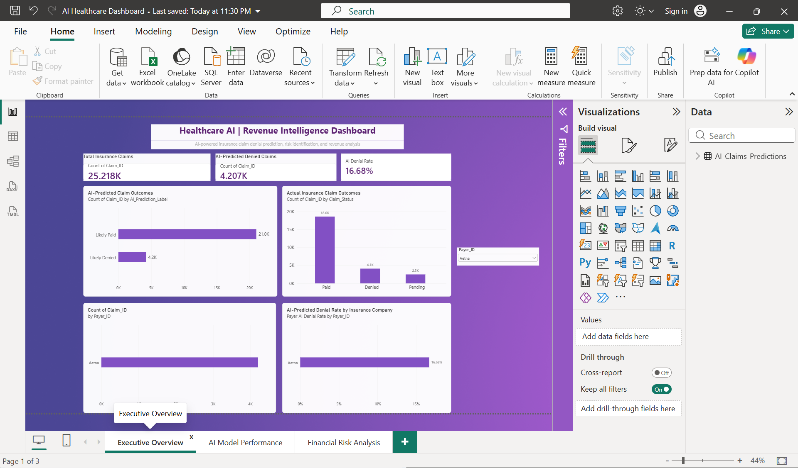
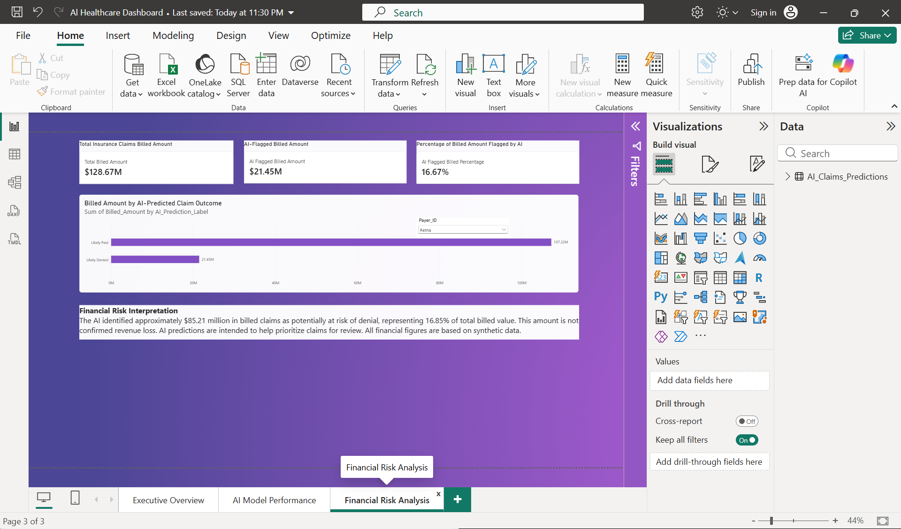
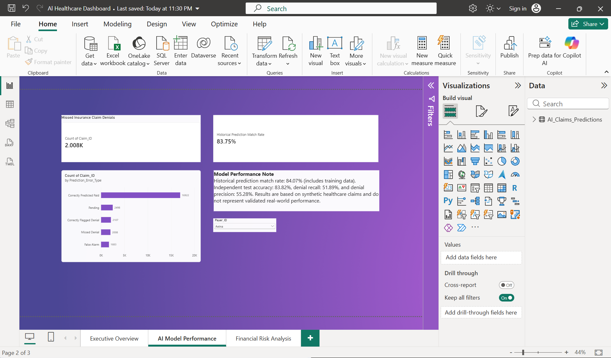

# Healthcare AI Revenue Intelligence

## 1. Project Objective

Develop a healthcare revenue intelligence prototype that uses machine learning to identify insurance claims at risk of denial and Power BI to visualize prediction outcomes, model performance, and potential financial exposure.

The project analyzes 100,000 synthetically generated healthcare claims, combining Python-based predictive modeling, MySQL data management, and interactive business intelligence reporting.

**Project Scope:** Educational and portfolio prototype using synthetic data. Not deployed or validated against real-world insurance claims.

## 2. Project Architecture and Technical Workflow

The project follows a five-stage analytical workflow.

**1. Data Generation:** Python was used to generate 100,000 synthetic healthcare insurance claims.

**2. Data Management:** MySQL was used to store structured claims data and support SQL-based exploration and analysis.

**3. Predictive Modeling:** A logistic regression model was developed in Python to predict claim denial risk using eligibility verification, coding validity, medical necessity, and submission delays.

**4. Prediction Output:** The trained model generated claim-level predictions and estimated denial probabilities, exported to a CSV file.

**5. Business Intelligence:** Power BI was used to develop three interactive report pages: Executive Overview, AI Model Performance, and Financial Risk Analysis. Synchronized insurance company filters support analysis across the report.

Power BI uses the exported prediction CSV rather than a live database connection.
## 3. Dataset Overview

The project uses a synthetically generated dataset of 100,000 healthcare insurance claims to simulate healthcare revenue cycle operations.

The dataset includes information such as:

- **Claim_ID:** Unique identifier for each insurance claim.
- **Patient_ID:** Synthetic patient identifier.
- **Provider_ID:** Healthcare provider identifier.
- **Payer_ID:** Insurance company associated with the claim.
- **CPT_Code and ICD_Code:** Procedure and diagnosis codes.
- **Billed_Amount:** Amount billed for healthcare services.
- **Claim_Status:** Paid, Denied, or Pending.
- **Eligibility_Verified:** Whether insurance eligibility was verified.
- **Coding_Valid:** Whether the claim passed coding validation.
- **Medical_Necessity_Met:** Whether medical necessity requirements were met.
- **Submission_Delay_Days:** Number of days between service and claim submission.

### Dataset Distribution

| Claim Status | Number of Claims |
|---|---:|
| Paid | 73,874 |
| Denied | 16,179 |
| Pending | 9,947 |
| **Total** | **100,000** |

### Data Limitations

All records are synthetic and do not contain real patient information. The dataset is intended for learning and demonstrating analytics workflows. Model performance on this dataset does not establish reliability on real healthcare claims.

## 4. Machine Learning Model Development

### Model Objective

### Model Comparison

Three machine learning algorithms were implemented and evaluated:

- **Logistic Regression:** Used as the primary binary classification model for predicting claim denials.
- **Decision Tree:** Trained as an alternative classification approach.
- **Random Forest:** Trained as an ensemble classification approach, with feature importance analysis to examine the relative contribution of input variables.

All three models were evaluated using a stratified 80/20 training and testing split, with accuracy, precision, and recall calculated on the held-out test dataset.

Logistic Regression was retained as the model used to generate the final claim-level predictions and Power BI reporting dataset.

The project demonstrates comparative model development, while the documented performance figures relate specifically to the final Logistic Regression model.

### Algorithm Used

**Logistic Regression (Binary Classification)**

Logistic regression was selected as a baseline classification algorithm because it is relatively interpretable and suitable for predicting binary outcomes, such as whether an insurance claim will be paid or denied.

### Input Features

The model uses four variables:

| Feature | Description |
|---|---|
| Eligibility_Verified | Whether the patient's insurance eligibility was verified |
| Coding_Valid | Whether the claim passed coding validation |
| Medical_Necessity_Met | Whether medical necessity requirements were met |
| Submission_Delay_Days | Number of days between service and claim submission |

### Model Training

The model was trained using historical claim records with finalized outcomes (Paid or Denied).

Pending claims were excluded from supervised training because their final outcomes were not yet known.

The dataset was divided into training and testing subsets to evaluate performance on held-out records.

### Independent Test Results

| Metric | Result |
|---|---:|
| Accuracy | 83.82% |
| Denial Precision | 55.28% |
| Denial Recall | 51.89% |

**Accuracy:** The proportion of test claims whose outcomes the model predicted correctly.

**Denial Precision:** The proportion of claims predicted as denied that were actually denied.

**Denial Recall:** The proportion of actual denied claims successfully identified by the model.

### Model Limitations

The model was trained and evaluated using synthetic healthcare claims rather than real-world insurance records.

Its performance therefore demonstrates the machine learning workflow but does not establish effectiveness in a production healthcare environment.

Additionally, the model misses some denied claims, so its predictions should be treated as decision-support estimates rather than definitive insurance decisions.

## 5. Power BI Dashboard Development

### Dashboard Overview

An interactive three-page Power BI report was developed to translate machine learning predictions into business intelligence insights.

The dashboard allows users to explore predicted insurance claim outcomes, evaluate historical model performance, and identify billed amounts associated with claims flagged as potentially at risk of denial.

### Page 1: Executive Overview

The Executive Overview provides a high-level summary of insurance claims and AI-generated predictions.

**Key Performance Indicators:**
- Total Insurance Claims: 100,000
- AI-Predicted Denied Claims: 16,795
- AI-Predicted Denial Rate: 16.80%

**Visualizations:**
- AI-Predicted Claim Outcomes
- Actual Insurance Claim Outcomes
- AI-Predicted Denied Claims by Insurance Company
- AI-Predicted Denial Rate by Insurance Company

This page helps users understand overall claim volumes, predicted denial patterns, and differences across insurance companies.

### Page 2: AI Model Performance

This page evaluates how AI predictions compare with finalized historical claim outcomes.

**Key Performance Indicators:**
- Historical Prediction Match Rate: 84.07%
- Missed Insurance Claim Denials: 7,712

The prediction performance breakdown includes correctly predicted paid claims, correctly flagged denials, missed denials, false alarms, and pending claims.

The historical prediction match rate includes records used during model training and should not be confused with independent test accuracy.

### Page 3: Financial Risk Analysis

This page examines billed amounts associated with AI-predicted claim outcomes.

**Key Performance Indicators:**
- Total Billed Amount: $505.60 million
- AI-Flagged Billed Amount: $85.21 million
- AI-Flagged Billed Percentage: 16.85%

A comparison chart shows billed amounts associated with claims predicted as likely paid versus likely denied.

**Financial Interpretation:** AI-flagged billed amounts represent potential exposure requiring review, not confirmed revenue losses.

### Interactive Features

An Insurance Company dropdown slicer is synchronized across all three report pages.

Users can select an insurance company to examine its claim volumes, predicted denial patterns, historical prediction results, and associated billed amounts.

The report uses DAX measures to calculate key performance indicators dynamically based on the selected filters.

### Business Value

The dashboard demonstrates how predictive analytics and business intelligence can support:

- Identification of claims requiring additional review.
- Analysis of denial risk patterns across insurance companies.
- Monitoring of prediction performance and missed denials.
- Prioritization of claims based on potential financial exposure.
- Data-driven revenue cycle management discussions.

All findings are based on synthetic data and illustrate potential analytical applications rather than validated operational outcomes.

## 6. Key Findings and Business Insights

### 1. AI-Based Denial Risk Identification

The machine learning model classified 16,795 of the 100,000 synthetic insurance claims as likely to be denied, representing approximately 16.80% of all claims.

This demonstrates how predictive analytics can help identify claims for additional review.

### 2. Model Performance and Missed Denials

The model achieved 83.82% accuracy on the independent test dataset, with 51.89% denial recall and 55.28% denial precision.

The historical prediction analysis also identified 7,712 missed denials, highlighting an important limitation: some claims that are eventually denied may not be flagged by the model.

This illustrates why denial recall is an important metric when evaluating predictive models for revenue cycle management.

### 3. Financial Exposure Analysis

The dataset contains approximately $505.60 million in total billed claims.

Of this amount, $85.21 million was associated with claims classified as likely denied, representing 16.85% of total billed value.

These figures demonstrate how AI predictions can be combined with financial data to identify claims that may warrant closer review.

The flagged amount does not represent confirmed revenue loss.

### 4. Insurance Company Analysis

The Power BI dashboard enables users to compare predicted denial volumes and denial rates across insurance companies.

Synchronized filters allow users to examine individual payers across claim outcomes, model performance, and financial exposure.

### 5. Project Limitations

- The dataset is entirely synthetic and does not represent actual patient or insurance company records.
- The model was developed using four input features, limiting the complexity of claim characteristics it can evaluate.
- The independent test results do not establish real-world predictive performance.
- The model does not guarantee approval, denial, or payment of an insurance claim.
- The Power BI report uses exported prediction data rather than a live production integration.
- Additional validation, richer datasets, and operational testing would be required before considering real-world deployment.

## 7. Conclusion

This project demonstrates an end-to-end analytical workflow integrating Python, MySQL, machine learning, and Power BI.

The solution combines structured data management, predictive modeling, model evaluation, financial analysis, and interactive reporting to explore how healthcare organizations could identify potential insurance claim denial risks.

Beyond building a prediction model, the project emphasizes interpreting results responsibly, recognizing model limitations, and communicating findings through business intelligence dashboards.

The completed solution serves as a portfolio demonstration of practical data analytics and machine learning skills using synthetic healthcare data.

## 8. Dashboard Screenshots

### Executive Overview

### AI Model Performance

### Financial Risk Analysis
